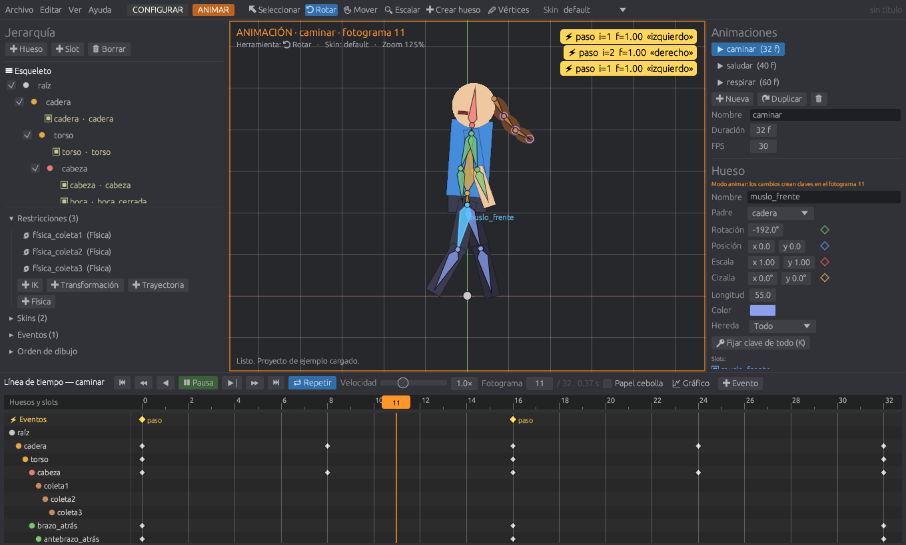
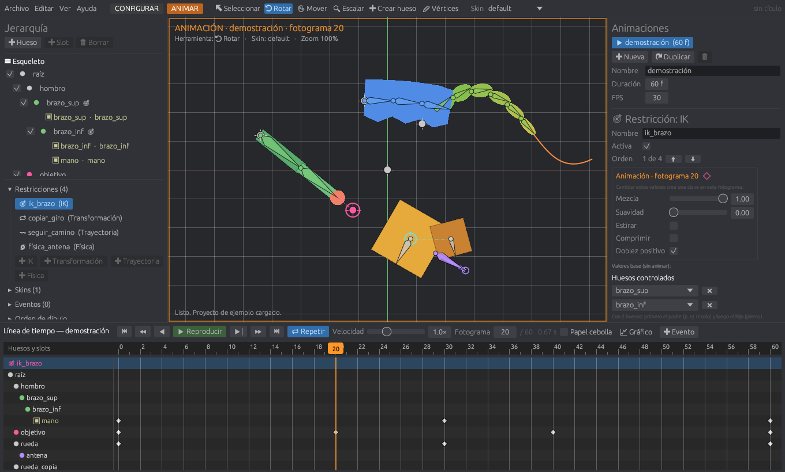
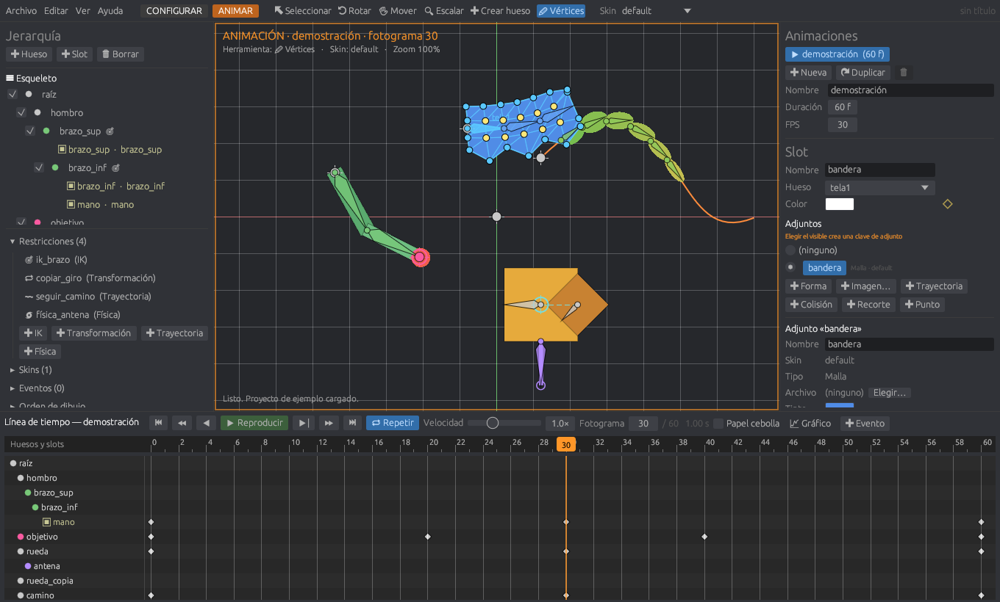
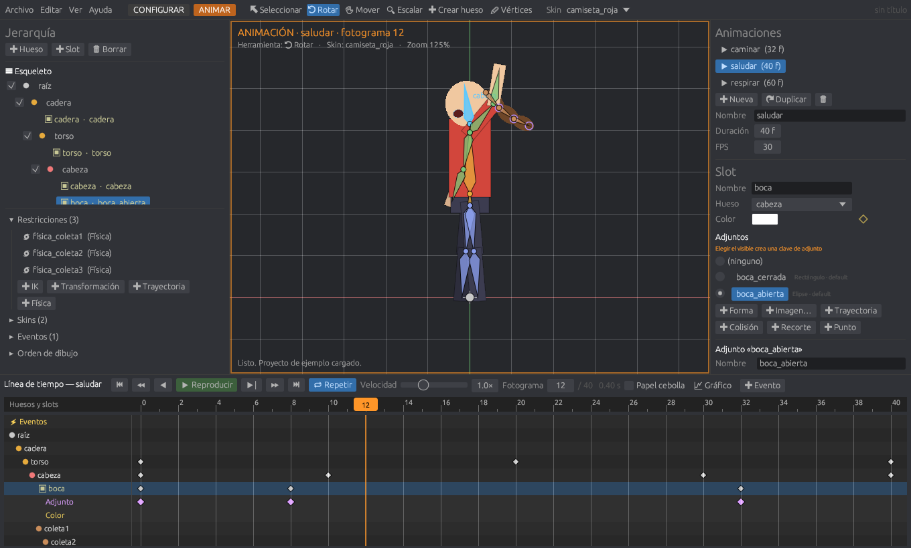
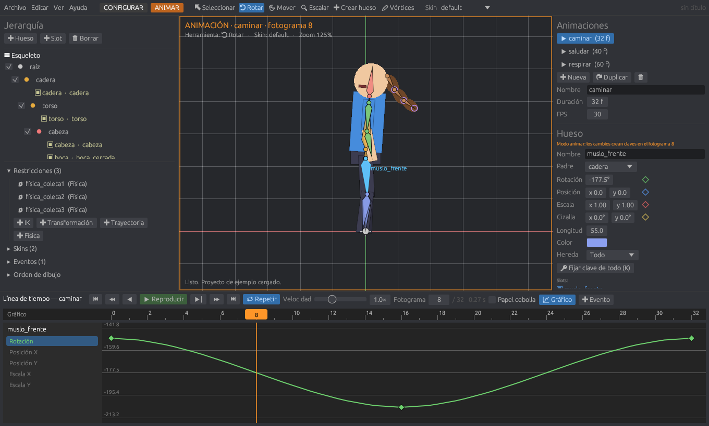

<div align="center">

# 🦴 Huesos Studio

**Editor de animación 2D con huesos, al estilo de Spine, gratis y en español.**

Monta un esqueleto, pégale imágenes, anímalo con fotogramas clave y expórtalo al formato de Spine para usarlo en tu juego.




</div>

---

## Índice

- [Qué es](#-qué-es)
- [Funciones](#-funciones)
- [Capturas](#-capturas)
- [Instalación](#-instalación)
  - [macOS](#-macos)
  - [Linux](#-linux)
  - [Windows](#-windows)
- [Primeros pasos](#-primeros-pasos)
- [Atajos de teclado](#️-atajos-de-teclado)
- [Compatibilidad con Spine](#-compatibilidad-con-spine)
- [Estructura del proyecto](#-estructura-del-proyecto)
- [Limitaciones conocidas](#-limitaciones-conocidas)

---

## ✨ Qué es

Huesos Studio es un programa de escritorio para hacer **animación esquelética 2D**: en vez de dibujar cada fotograma, creas un esqueleto de huesos, colocas imágenes encima y mueves los huesos. El programa calcula los fotogramas intermedios.

Es un único ejecutable pequeño, sin instalador ni dependencias, con toda la interfaz en español. Funciona igual en Windows, Linux y Mac.

Trae dos ejemplos listos para tocar:

- **Muñeco**: camina, saluda y respira, con coleta con física, boca que se abre y una skin roja.
- **Ejemplo de restricciones**: un brazo con IK, ruedas que se copian el giro, una serpiente que sigue una curva, una bandera deformable y una antena que rebota.

---

## 🧰 Funciones

### Esqueleto
| | |
|---|---|
| 🦴 **Huesos** | Crea, mueve, gira, escala y emparenta huesos arrastrando en el lienzo. |
| 📐 **Cizalla y herencia** | Cada hueso puede inclinarse (cizalla) y elegir qué hereda de su padre: todo, solo la posición, sin rotación o sin escala. |
| 🧍 **Modos Configurar / Animar** | La pose base se edita aparte de las animaciones, como en Spine (cambia con `Tab`). |

### Imágenes y adjuntos
| | |
|---|---|
| ▣ **Slots** | Capas de dibujo pegadas a un hueso. Cada slot puede tener varios adjuntos y elegir cuál se ve. |
| 👕 **Skins** | Cambia la ropa o el aspecto del mismo esqueleto con un clic. |
| 🖼️ **Imágenes y formas** | PNG o JPG, o rectángulos y elipses de color para prototipar. |
| ✏️ **Mallas deformables** | Convierte una imagen en malla y dobla sus vértices con la herramienta **Vértices (M)**. |
| ⚖️ **Pesos** | Reparte cada vértice entre varios huesos para que la imagen se doble de forma natural (codos, colas, telas). |
| ✂️ **Recorte** | Un polígono que recorta lo que se dibuja después (portales, ventanas, máscaras). |
| 🎯 **Colisión y puntos** | Cajas de colisión y puntos con dirección para usar en el juego (disparos, partículas). |
| 〰️ **Trayectorias** | Curvas Bézier editables para que los huesos las sigan. |

### Restricciones
| | |
|---|---|
| 🎯 **IK** | Uno o dos huesos apuntan a un objetivo (brazos, piernas), con doblez, suavidad, estirar y comprimir. |
| 🔁 **Transformación** | Un hueso copia la rotación, posición, escala o cizalla de otro, con desfases y mezclas. |
| 〰️ **Trayectoria** | Una cadena de huesos sigue una curva (serpientes, cuerdas, colas). |
| 🌀 **Física** | Rebote con inercia, rigidez, amortiguación, masa, gravedad y viento. |

Las mezclas de todas las restricciones **se pueden animar**.

### Animación
| | |
|---|---|
| 🎞️ **Línea de tiempo** | Claves por hueso y canal (rotación, posición, escala, cizalla) que se arrastran para moverlas. |
| 📈 **Curvas Bézier** | Editor de asas por clave, con atajos (entrada, salida, rebote, anticipar) y **vista de gráfico (G)**. |
| 🎨 **Más cosas animables** | Adjunto visible, color del slot, deformación de mallas, orden de dibujo y restricciones. |
| ⚡ **Eventos** | Marcas en el tiempo (pasos, golpes, sonidos) con valores, que se ven al reproducir. |
| 👻 **Papel cebolla** | Muestra las poses de los fotogramas de antes y de después. |
| ▶️ **Reproducción** | Con repetición y velocidad ajustable. Deshacer y rehacer de hasta 300 pasos. |

### Archivos
| | |
|---|---|
| 💾 **Proyectos** | Formato JSON propio. Los proyectos de la versión anterior se abren y se convierten solos. |
| 📤 **Exportar a Spine** | `.json` + `.atlas` + `.png` con todas las imágenes y formas empaquetadas en una textura. |
| 📥 **Importar de Spine** | Lee esqueletos de Spine 4.x y 3.8 y recorta las imágenes del atlas automáticamente. |

---

## 📸 Capturas

<table>
<tr>
<td width="50%"><br><sub><b>Restricciones:</b> IK en el brazo, trayectoria en la serpiente, transformación en las ruedas y física en la antena. A la derecha, las mezclas animables.</sub></td>
<td width="50%"><br><sub><b>Malla con pesos:</b> la bandera se dobla con tres huesos. Con la herramienta Vértices se mueven los puntos.</sub></td>
</tr>
<tr>
<td><br><sub><b>Skins y adjuntos:</b> la skin «camiseta_roja» y la boca que cambia de cerrada a abierta al saludar.</sub></td>
<td><br><sub><b>Vista de gráfico:</b> la curva de rotación del muslo al caminar, con sus claves editables.</sub></td>
</tr>
</table>

---

## 📦 Instalación

Huesos Studio es un solo archivo ejecutable: no hace falta instalar nada más.

### 🍎 macOS

**Descargar la app ya hecha** (Intel y Apple Silicon, macOS 11 o posterior):

1. Entra en la pestaña [**Actions**](../../actions/workflows/mac.yml) de este repositorio (hace falta iniciar sesión en GitHub).
2. Abre la última ejecución en verde de **«Ejecutable para Mac»**.
3. Abajo, en **Artifacts**, descarga **HuesosStudio-mac**.
4. Descomprime: dentro está `HuesosStudio-mac.zip`, y dentro, **Huesos Studio.app**. Arrástrala a *Aplicaciones*.

**La primera vez macOS la bloquea** porque no está firmada con un certificado de pago de Apple. Haz clic derecho sobre la app → **Abrir** → **Abrir**. Si dice que *«está dañada»*, ejecuta esto en la Terminal y vuelve a abrirla:

```bash
xattr -dr com.apple.quarantine "/Applications/Huesos Studio.app"
```

**Compilarla tú mismo en un Mac:**

```bash
xcode-select --install                                         # herramientas de Apple
curl --proto '=https' --tlsv1.2 -sSf https://sh.rustup.rs | sh  # Rust
git clone https://github.com/P4NKK-TRYHARD/huesos-studio
cd huesos-studio/app
cargo run --release
```

> 💡 Para generar una nueva app de Mac sin tener Mac: **Actions → Ejecutable para Mac → Run workflow**. GitHub la compila en uno de sus Macs en unos 2 minutos.

### 🐧 Linux

**1. Instala las dependencias** (librerías de ventanas y gráficos):

<details open>
<summary><b>Fedora</b></summary>

```bash
sudo dnf install gcc libxkbcommon-devel wayland-devel libX11-devel mesa-libGL-devel
```
</details>

<details>
<summary><b>Ubuntu / Debian / Linux Mint</b></summary>

```bash
sudo apt install build-essential pkg-config libx11-dev libxkbcommon-dev libgl1-mesa-dev libwayland-dev
```
</details>

<details>
<summary><b>Arch / Manjaro</b></summary>

```bash
sudo pacman -S base-devel libxkbcommon wayland libx11 mesa
```
</details>

**2. Instala Rust y compila:**

```bash
curl --proto '=https' --tlsv1.2 -sSf https://sh.rustup.rs | sh
git clone https://github.com/P4NKK-TRYHARD/huesos-studio
cd huesos-studio/app
cargo run --release
```

El ejecutable queda en `app/target/release/huesos-studio`. Puedes copiarlo donde quieras, por ejemplo a `~/.local/bin/`.

### 🪟 Windows

1. Instala **[Visual Studio Build Tools](https://visualstudio.microsoft.com/es/visual-cpp-build-tools/)** y marca «Desarrollo para el escritorio con C++».
2. Instala **Rust** con [rustup-init.exe](https://rustup.rs).
3. En PowerShell:

```powershell
git clone https://github.com/P4NKK-TRYHARD/huesos-studio
cd huesos-studio\app
cargo run --release
```

El programa queda en `app\target\release\huesos-studio.exe` y se abre con doble clic.

> ⏱️ La primera compilación tarda unos minutos en cualquier sistema porque descarga y compila las librerías. Las siguientes van mucho más rápido.

---

## 🚀 Primeros pasos

1. **Prueba los ejemplos:** *Archivo → Cargar ejemplo de restricciones* y pulsa `Espacio`.
2. **Proyecto nuevo:** *Archivo → Nuevo proyecto*. Con la herramienta **Crear hueso** (`C`), arrastra en el lienzo para dibujar huesos. El hueso seleccionado es el padre del siguiente.
3. **Pon imágenes:** selecciona un hueso → **✚ Slot** → en el panel derecho **✚ Imagen…**
4. **Anima:** pulsa `Tab` para pasar a **ANIMAR**, elige un fotograma en la línea de tiempo y gira o mueve huesos. Cada cambio crea una clave.
5. **Ajusta el ritmo:** haz clic en un rombo de la línea de tiempo y cambia su curva en el panel **Clave**, o abre la **vista de gráfico** (`G`).
6. **Guarda o exporta:** `Ctrl+S` guarda el proyecto. *Archivo → Exportar a Spine* genera los archivos para el juego.

> 📝 Los cambios en modo **CONFIGURAR** modifican la pose base. En modo **ANIMAR** crean claves en el fotograma actual.

---

## ⌨️ Atajos de teclado

| Tecla | Acción | | Tecla | Acción |
|:---:|---|---|:---:|---|
| `V` | Seleccionar | | `Espacio` | Reproducir / pausa |
| `R` | Rotar | | `←` `→` | Fotograma anterior / siguiente |
| `T` | Mover | | `K` | Clave de todo el hueso |
| `S` | Escalar | | `G` | Vista de gráfico |
| `C` | Crear hueso | | `Tab` | Configurar ↔ Animar |
| `M` | Vértices (mallas y trayectorias) | | `Supr` | Borrar clave o hueso |
| `Ctrl+Z` | Deshacer | | `Ctrl+Y` | Rehacer |
| `Ctrl+S` | Guardar | | `Ctrl+O` | Abrir |
| Rueda | Zoom | | Botón derecho | Mover la vista |

`Mayús` al arrastrar un asa de trayectoria la mueve sin la simetría.

---

## 🔄 Compatibilidad con Spine

Huesos Studio exporta e importa el formato **JSON de Spine 4.2** (e importa también 3.8), con su **atlas** de texturas.

Para comprobar que es compatible de verdad, los archivos se cargaron en el **runtime oficial de Spine** (`spine-core`) y se compararon las posiciones fotograma a fotograma:

| Prueba | Resultado |
|---|---|
| Ejemplos de Huesos Studio exportados | Huesos, adjuntos, colores, skins y eventos coinciden (menos de 0,5 px). Trayectorias a ~1 px |
| *Spineboy* (ejemplo oficial de Spine) importado, 11 animaciones | Menos de 1 px de diferencia; casi todas por debajo de 0,2 px |
| *Raptor* (ejemplo oficial de Spine) importado, 5 animaciones | Menos de 0,3 px de diferencia |

Huesos Studio reproduce el comportamiento exacto de los runtimes: el mismo IK, la misma aproximación de curvas Bézier, la misma herencia de transformaciones y el mismo orden de restricciones.

> ⚠️ **Licencia de Spine:** para usar la animación exportada en **Unity, Godot, Unreal, Phaser…** con los runtimes oficiales de Spine necesitas una [licencia de Spine](https://esotericsoftware.com/spine-purchase). Huesos Studio no la necesita para funcionar.

---

## 🗂️ Estructura del proyecto

```
app/
├── Cargo.toml
└── src/
    ├── main.rs       arranque y opciones de línea de órdenes
    ├── app.rs        estado del editor, archivos y atajos
    ├── model.rs      datos: huesos, slots, skins, adjuntos, restricciones, animaciones
    ├── pose.rs       cálculo de la pose: herencia, IK, transformación, trayectoria, física
    ├── mesh.rs       mallas en rejilla y pesos automáticos
    ├── clip.rs       recorte de triángulos contra polígonos
    ├── canvas.rs     lienzo: dibujo y herramientas
    ├── panels.rs     barra superior y panel izquierdo
    ├── props.rs      panel de propiedades
    ├── timeline.rs   línea de tiempo y vista de gráfico
    ├── draw.rs       estilo y utilidades de dibujo
    ├── filedlg.rs    selector de archivos propio
    ├── sample.rs     proyectos de ejemplo
    └── spine_io.rs   exportar e importar Spine (JSON + atlas)
```

Hecho en **Rust** con [egui / eframe](https://github.com/emilk/egui). Para pasar las pruebas: `cd app && cargo test`.

<details>
<summary><b>Abrir la app en un estado concreto (línea de órdenes)</b></summary>

```bash
huesos-studio proyecto.json                 # abre un proyecto o un JSON de Spine
huesos-studio --ejemplo restricciones       # carga el ejemplo de restricciones
huesos-studio --animacion caminar --fotograma 10 --hueso muslo_frente --grafico
huesos-studio --skin camiseta_roja --slot boca --herramienta vertices
huesos-studio --exportar salida/personaje.json   # exporta a Spine al arrancar
huesos-studio --screenshot captura.png      # guarda una captura y se cierra
```
</details>

---

## 🚧 Limitaciones conocidas

- **Firma de Apple:** la app de Mac no está firmada ni notarizada, así que hay que abrirla con clic derecho la primera vez.
- **Física:** se simula con un modelo propio. Al exportar, sus parámetros se traducen a los de Spine de forma aproximada, así que el rebote puede verse algo distinto en el juego.
- **Importar de Spine:**
  - Las trayectorias con pesos y las mallas enlazadas con deformaciones propias se simplifican.
  - Los tiempos se ajustan a 30 fps.
  - Las deformaciones de mallas con pesos se convierten a una sola por vértice.
- **Sin probar a mano en Windows y Mac:** el código es el mismo en todos los sistemas, pero solo se ha usado a fondo en Linux.

---

<div align="center">
<sub>Hecho con 🦴 y Rust · Huesos Studio 0.2</sub>
</div>
